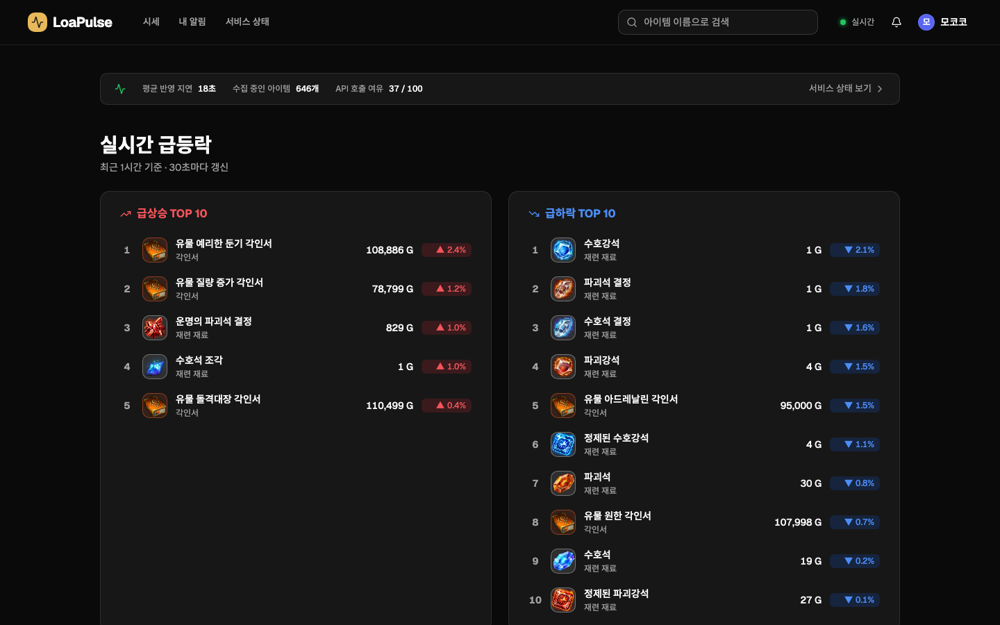
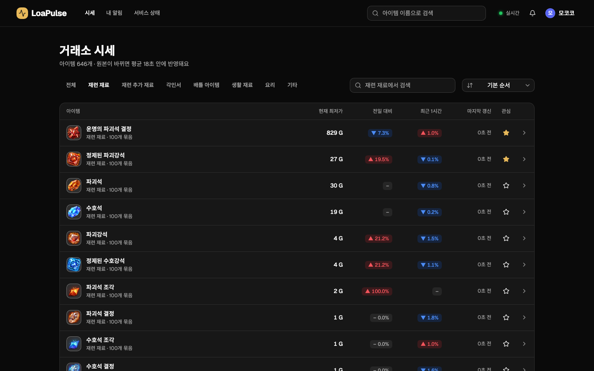
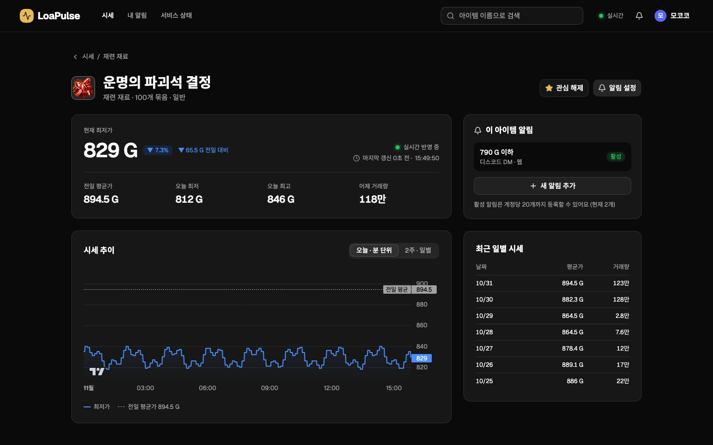
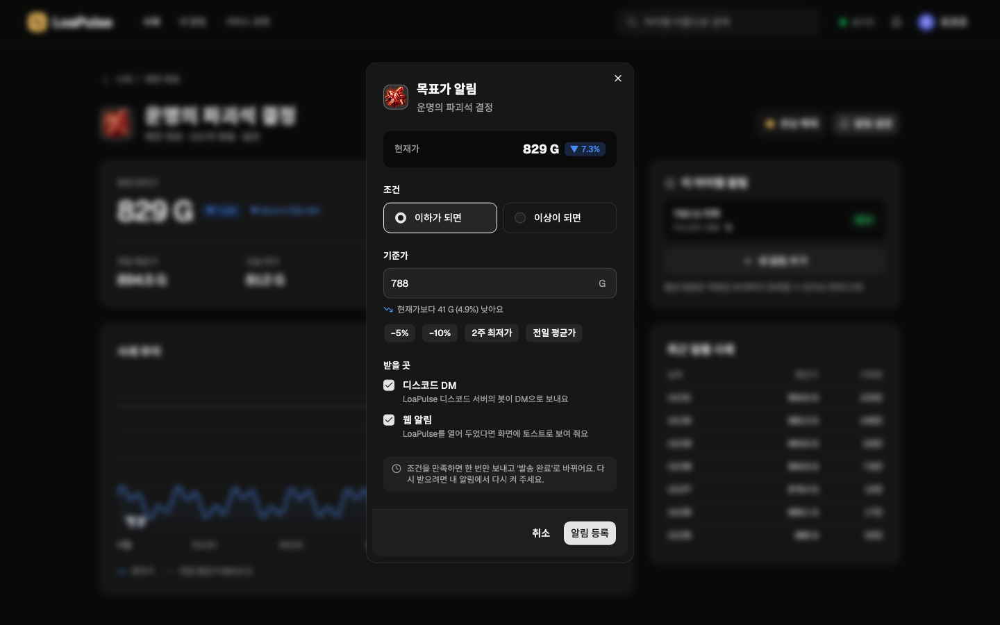
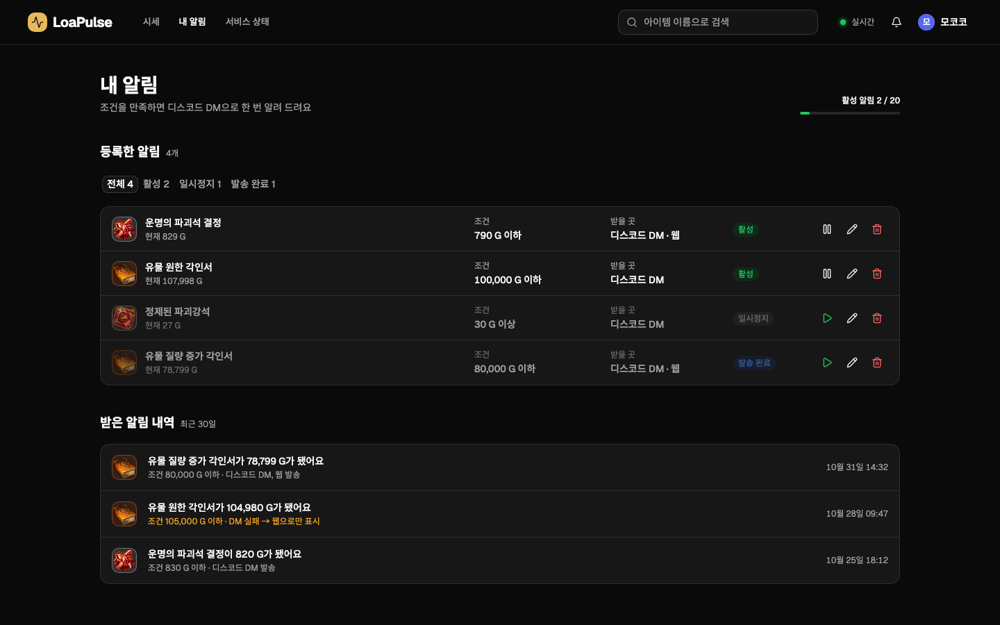
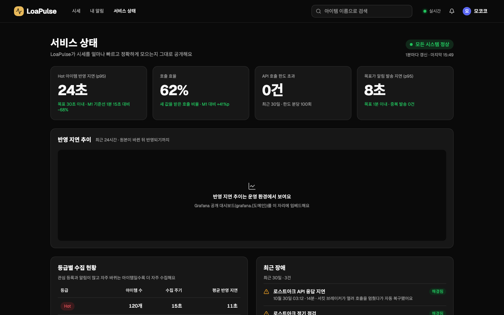

# LoaPulse Frontend

> 로스트아크 거래소 시세를 실시간으로 추적하고, 원하는 가격이 되면 디스코드로 알려주는 서비스의 프론트엔드

기획과 설계는 [loa-pulse-docs](https://github.com/loa-pulse/loa-pulse-docs)에 있다. 화면은 Figma 디자인을 따른다 (데스크톱 전용, 다크 테마).

## 화면

| 메인 · 실시간 급등락과 내 관심 아이템            | 시세 목록                                      |
| ------------------------------------------------ | ---------------------------------------------- |
|                |        |
| **아이템 상세 · 실시간 가격, 오늘·2주 차트**     | **목표가 알림 등록**                           |
|  |  |
| **내 알림 · 등록한 알림과 받은 알림 내역**       | **서비스 상태 · 수집 신선도 공개**             |
|           |     |

- **실시간**: 브라우저당 SSE 연결 하나로 보고 있는 아이템의 가격, 갱신 시각, 랭킹, 웹 알림을 받는다. 끊기면 1초 → 30초 간격으로 다시 연결하고, 탭을 10분 넘게 숨기면 연결을 끊는다.
- **신선도**: 1분 넘게 새 값을 받지 못한 아이템은 갱신 시각을 주황으로, 수집이 지연되면 화면 위에 배너를 띄운다.
- **알림 흐름(S1)**: 상세에서 알림 설정 → 로그인 안내 → 디스코드 로그인 → 상세로 돌아와 모달이 열린 채로 등록 → 조건을 만족하면 디스코드 DM과 웹 토스트.
- 화면은 목업으로 찍었다. 수치는 예시 값이다.

## 기술 스택

| 영역          | 선택                                                 |
| ------------- | ---------------------------------------------------- |
| 빌드          | Vite, TypeScript                                     |
| UI            | React 19, shadcn/ui (Radix), Tailwind CSS v4, sonner |
| 서버 상태     | TanStack Query (SSE 이벤트로 캐시를 직접 갱신)       |
| 라우팅        | React Router (경로별 코드 분할)                      |
| 차트          | lightweight-charts                                   |
| 폼            | react-hook-form, zod                                 |
| API 목업      | MSW (개발, 프리뷰, 테스트가 같은 핸들러를 쓴다)      |
| 테스트        | Vitest, Testing Library, Playwright                  |
| 코드 품질     | ESLint, Prettier                                     |
| 배포          | Vercel (D28)                                         |
| 패키지 매니저 | pnpm (`packageManager` 필드로 버전 고정)             |

선택 이유는 [D7](https://github.com/loa-pulse/loa-pulse-docs/blob/main/design/decisions.md)과 [08-frontend-plan](https://github.com/loa-pulse/loa-pulse-docs/blob/main/planning/08-frontend-plan.md)의 "정한 것"을 따른다.

## 실행

필요한 것: Node 24 (`.nvmrc`), pnpm (`corepack enable`로 `packageManager` 버전을 사용)

```bash
pnpm install
pnpm dev
```

개발 서버는 `/api` 요청을 `http://localhost:8080`(백엔드)으로 넘긴다.

### 환경 변수

`.env.example`을 `.env.local`로 복사해서 쓴다.

| 변수                         | 내용                                                                     |
| ---------------------------- | ------------------------------------------------------------------------ |
| `VITE_API_BASE_URL`          | 백엔드 주소. 비우면 같은 출처의 `/api`. 운영은 `https://api.{도메인}`    |
| `VITE_USE_MOCK`              | `true`면 MSW 목업으로 API와 SSE를 흉내 낸다 (백엔드 없이 화면 확인)      |
| `VITE_DISCORD_INVITE_URL`    | LoaPulse 디스코드 서버 초대 링크 (서버를 나간 사용자의 "서버 다시 참여") |
| `VITE_GRAFANA_DASHBOARD_URL` | 서비스 상태 화면에 임베드할 Grafana 공개 대시보드 주소                   |

### 목업으로 둘러보기

`VITE_USE_MOCK=true`면 로그인도 목업이다. "디스코드로 로그인"을 누르면 디스코드를 거치지 않고 바로 로그인된다. 로그인 상태와 알림은 브라우저 저장소(`loapulse.mock.*`)에 남으므로, 처음 상태로 돌아가려면 저장소를 지우거나 설정에서 탈퇴한다. 로그인한 채로 15초쯤 있으면 웹 알림 토스트가 한 번 온다.

## 스크립트

| 명령                                | 내용                                                                                                 |
| ----------------------------------- | ---------------------------------------------------------------------------------------------------- |
| `pnpm dev`                          | 개발 서버                                                                                            |
| `pnpm build`                        | 타입 검사 후 빌드                                                                                    |
| `pnpm test` / `pnpm test:watch`     | Vitest 실행 / 감시 모드                                                                              |
| `pnpm test:e2e`                     | Playwright E2E (목업 서버를 띄워 S1 시나리오 실행). 처음에는 `pnpm exec playwright install chromium` |
| `pnpm lint`                         | ESLint                                                                                               |
| `pnpm format` / `pnpm format:check` | Prettier 서식 적용 / 검사                                                                            |

CI는 PR과 `main` push마다 `lint`, `format:check`, `test`, `build`, `test:e2e`를 실행한다.

## 배포 (Vercel)

`vercel.json`에 빌드 명령과 SPA 폴백(모든 경로 → `index.html`)이 있다. Vercel 프로젝트를 이 저장소와 Git 연동하면 `main`은 운영으로, PR은 프리뷰로 배포된다.

| Vercel 환경 | `VITE_API_BASE_URL`    | `VITE_USE_MOCK` |
| ----------- | ---------------------- | --------------- |
| Production  | `https://api.{도메인}` | 비움            |
| Preview     | 비움                   | `true`          |

프리뷰 주소(`*.vercel.app`)는 백엔드와 같은 사이트가 아니라 로그인 쿠키가 전달되지 않는다. 그래서 프리뷰는 목업으로만 확인한다 (D28).

## 폴더 구조

```
src/
├── components/
│   ├── ui/          shadcn/ui 컴포넌트 (pnpm dlx shadcn add <이름>)
│   ├── layout/      헤더 등 공통 레이아웃
│   └── *.tsx        여러 화면이 함께 쓰는 UI (PriceChange, ItemThumb 등)
├── features/        도메인별 api, hooks, components
│   ├── market/      시세 목록, 상세, 차트, 랭킹
│   ├── realtime/    SSE 연결, 이벤트로 캐시 갱신
│   ├── auth/        로그인 상태, 로그인 안내, 로그인 필요 화면
│   ├── alerts/      목표가 알림, 받은 알림 내역, 웹 알림 토스트
│   ├── watch/       관심 아이템
│   ├── settings/    설정, DM 실패 배너
│   └── status/      서비스 상태
├── api/             API 클라이언트(쿠키, CSRF, 오류), 응답 타입
├── mocks/           MSW 목업 (data: 예시 데이터와 상태, handlers: 05-api 계약)
├── lib/             공통 유틸리티 (포맷, 환경 변수, QueryClient)
├── pages/           라우트별 페이지
├── test/            테스트 설정
e2e/                 Playwright E2E
├── App.tsx          공통 레이아웃
├── router.tsx       경로 설정
└── main.tsx         진입점 (Provider)
```

shadcn/ui 컴포넌트를 추가한 뒤에는 `cn`을 `@/lib/utils`에서 가져오는지 확인한다 (생성기가 `cn` 패키지를 직접 import할 수 있다).

## 브랜치 전략

`main`과 작업 브랜치(`feat/...`, `fix/...`)로 운영하고, PR은 머지 커밋으로 합친다 ([D25](https://github.com/loa-pulse/loa-pulse-docs/blob/main/design/decisions.md)).
